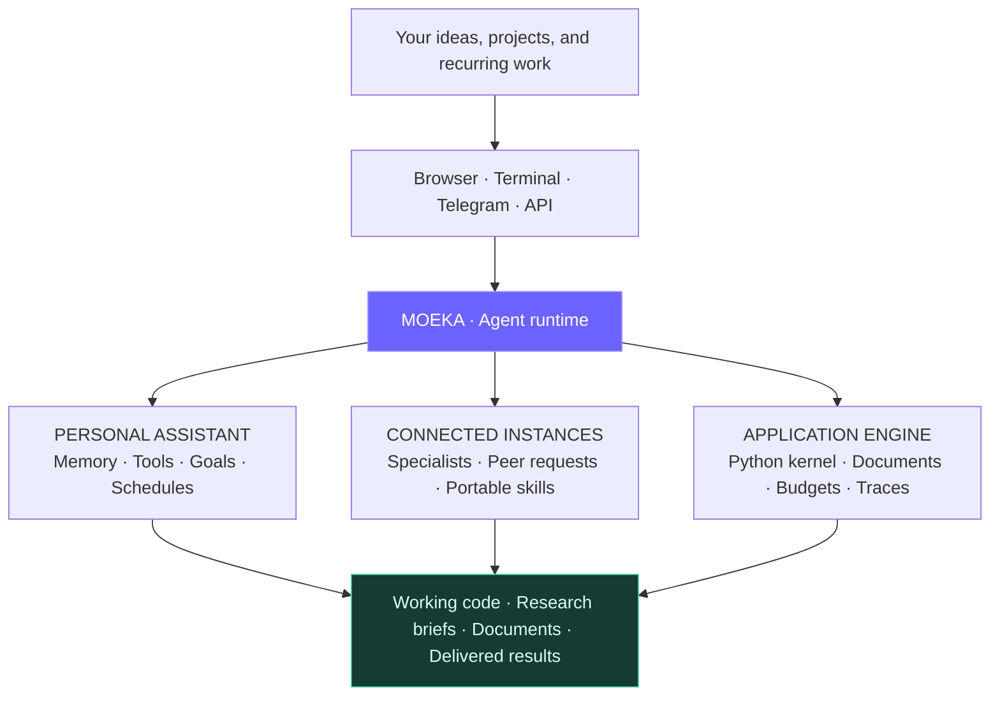

<div align="center">


**Your personal AI. Your agent engine. Your experimental self-improvement lab.**

[Get started](#get-started) · [Why Moeka](#why-moeka) · [Use cases](#put-moeka-to-work) · [Experimental RSI](#the-frontier-experimental-rsi) · [Documentation](#explore-moeka)


[](./LICENSE)

</div>

Moeka turns AI into an ongoing working relationship. It remembers what matters, acts through real tools, carries work across sessions, and brings results back to your browser, terminal, or chat. Run a personal assistant, build a team of specialized instances, or embed the same agent engine inside your own application.

**The ambition: make every conversation useful today, and turn useful work into reusable capability for tomorrow.** Alongside its daily assistant runtime, Moeka provides the foundation for an experimental recursive self-improvement (RSI) system that explores how agents can develop and test better ways of working.

## Why Moeka

| Advantage | What it unlocks |
|---|---|
| **Context that compounds** | Durable conversations, explicit memory tools, and Dream consolidation preserve useful knowledge across sessions. Spend less time re-explaining your work. |
| **Real execution power** | Files, shell commands, web research, notebooks, image generation, MCP integrations, and delegated workers let Moeka move from a request to an artifact. |
| **Work that keeps moving** | Sustained goals and scheduled tasks support work beyond a single reply. A persistent gateway keeps configured channels and automations online after clients close. |
| **An assistant team you own** | Independent instances have their own personality, memory, credentials, schedules, and permissions. Pair them to exchange authenticated work requests locally or over HTTPS. |
| **Freedom to choose the brain** | Hosted providers and local OpenAI-compatible models share one runtime. Opt-in Luna/GPU routing offers task-level selection with bounded fallback when the GPU is unavailable. |
| **Capabilities worth keeping** | Reusable skills and script tools capture working methods. Certificate-verified transfers let owners move approved capabilities between instances without moving private conversations or credentials. |
| **A foundation for your products** | The embeddable Python kernel exposes agents, structured model calls, document memory, branching sessions, budgets, and traces through one public API. |

**Own the workspace. Choose the models. Build the workflow. Keep the capability.**

## One engine, three ways to build



Start with one assistant. Add specialized instances when your work needs them. Use the kernel when you want the same capabilities inside a product. Moeka connects personal productivity, agent coordination, and application development in one stack.

## Put Moeka to work

These are example workflows to configure and request, with the relevant tools and integrations enabled.

| Use it as… | Ask it to… | What makes it useful |
|---|---|---|
| **A daily working partner** | “Remember this project's constraints. Help me plan the next milestone and remind me on Friday.” | Persistent memory, ongoing sessions, and scheduled reminders. |
| **A coding collaborator** | “Inspect this repository, fix the failing behavior, run the relevant checks, and explain the changes.” | Workspace tools, shell execution, skills, and delegated workers. |
| **A research and document assistant** | “Compare these sources and files, then write a brief with the key tradeoffs.” | Web search and fetch, document processing, and reusable notes. |
| **A recurring operations assistant** | “Check this project every morning and send me a status update.” | Cron automation, a long-running gateway, and channel delivery. |
| **A creative project coordinator** | “Send these references to the paired creative agent and bring its output back here.” | The optional Wonhee bridge connects selected Telegram conversations to a paired creative instance with durable intake and delivery tracking. |
| **An agent-powered application backend** | Build a document assistant, coaching workflow, or task-specific agent inside your own product. | An embeddable kernel with scoped memory, host-supplied tools, usage accounting, and tracing. |

### Your agents can specialize without losing their independence

Give one instance your everyday work, another a focused project, and another an experimental role. Each keeps its own state and access rules. Owner-paired peers can request work from each other while the recipient uses its own tools and permissions.

Reusable capabilities can travel separately: preview a certified bundle, stage it, approve it, and activate it at the appropriate boundary. Transfer history and rollback make adoption reviewable. Your assistant's personality and private memory stay with that assistant.

[Daily assistants](./docs/daily-agents.md) · [Multiple instances](./docs/multiple-instances.md) · [Pairing agents](./docs/guides/paired-agents.md) · [Capability transfer](./docs/capability-transfer.md)

## The frontier: experimental RSI

**What if an agent could improve the way it works—and make those improvements reusable?**

Moeka's experimental **recursive self-improvement** system explores that possibility through a companion harness, **moeka-rsi**. The direction is ambitious: use agent experience to develop better skills, tools, prompts, and operating variants, evaluate candidates, and feed accepted capabilities into future work.


The advantage is bigger than any single answer: **a useful method can become a capability, and a capability can become a building block for the next task.** This is the research bet behind Moeka's improvement loop.

The repository already supplies concrete building blocks:

- **Controlled experiments:** candidate variants, agent fingerprints, run limits, tool policies, and traceable model/tool activity.
- **Independent checks:** a held-out test runner and a Docker sandbox mode for evaluation outside the candidate's working context.
- **Reusable capabilities:** certificate verification, destination permission checks, staged transfers, activation history, and rollback.
- **Observable cost:** model-call accounting, budgets, and traces for inspecting how an agent spends its resources.

**RSI is experimental.** The companion harness owns candidate development, evaluation, and signing; this repository supplies the runtime and integration surfaces. The loop above describes the research direction, not a claim of demonstrated autonomous improvement. Capability promotion is manual, automatic promotion is off, and core changes require reviewed patches. Daily Moeka assistants run independently of RSI.

[RSI system overview and status](./specs/004-rsi-harness/spec.md) · [Kernel architecture](./docs/core-architecture.md) · [Certified capability transfers](./docs/capability-transfer.md)

## Get started

Install this Moeka checkout to get the features described here. You need **Python 3.11+**, access to a model provider or local model server, and **Bun** for the source WebUI and native terminal client.

```bash
git clone https://github.com/Muxite/moeka.git
cd moeka
python -m venv .venv
```

Activate the environment with `source .venv/bin/activate` on macOS/Linux or `.venv\Scripts\Activate.ps1` in Windows PowerShell, then:

```bash
python -m pip install -e .
moeka webui
```

In **Settings → Models**, configure your provider and model, start a conversation, and choose the intended workspace before asking Moeka to work on a project.

| Next step | Command or guide |
|---|---|
| Work in the terminal | `moeka` |
| Send a single request | `moeka -m "Help me plan my next project"` |
| Keep channels and automations running | `moeka gateway --background` |
| Check the background gateway | `moeka gateway status` |
| Create a named assistant from the checkout | `bin/moeka.sh new research` |
| Configure independent assistants and Luna/GPU routing | [Daily-agent setup](./docs/daily-agents.md) |
| Embed Moeka in an application | [Python SDK](./docs/python-sdk.md) |

Telegram is included. Additional chat integrations install on demand; Discord is also available with `python -m pip install -e ".[discord]"`. Provider credentials, local inference, peer pairing, and RSI each need their own configuration.

## Explore Moeka

| Build on… | Read… |
|---|---|
| **Your assistant** | [Daily agents](./docs/daily-agents.md) · [Memory](./docs/memory.md) · [Automations](./docs/automations.md) |
| **Your interface** | [WebUI](./docs/webui.md) · [Chat apps](./docs/chat-apps.md) · [CLI reference](./docs/cli-reference.md) |
| **Your agent team** | [Multiple instances](./docs/multiple-instances.md) · [Peer messaging](./docs/guides/paired-agents.md) · [Capability transfer](./docs/capability-transfer.md) |
| **Your model stack** | [Providers](./docs/providers.md) · [Provider cookbook](./docs/provider-cookbook.md) · [Configuration](./docs/configuration.md) |
| **Your application** | [Python SDK](./docs/python-sdk.md) · [OpenAI-compatible API](./docs/openai-api.md) · [Kernel architecture](./docs/core-architecture.md) |
| **Your deployment** | [Deployment](./docs/deployment.md) · [Development](./docs/development.md) · [Troubleshooting](./docs/troubleshooting.md) |

<sub>MIT licensed. Built on nanobot; upstream attribution is retained in [LICENSE](./LICENSE) and [third-party notices](./THIRD_PARTY_NOTICES.md). The `nanobot` command remains a compatibility alias, and some detailed guides retain upstream naming.</sub>
