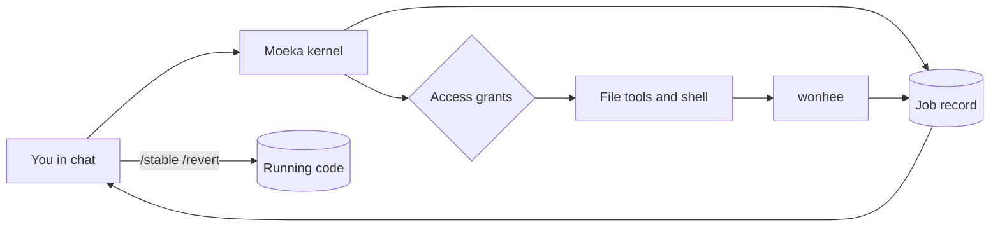
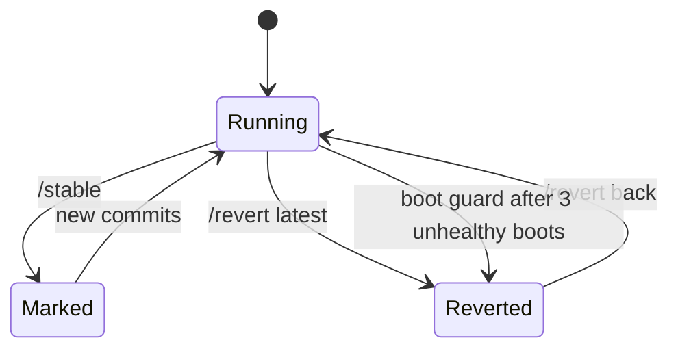

# Operating Moeka: jobs, access and safe self-change

This page covers how Moeka works as a trustworthy operator for one person's machines and projects. It
explains what you can see, what it may touch, and how you recover when a change goes wrong. The design
record is [`specs/015-central-plan/spec.md`](../specs/015-central-plan/spec.md).



## Job records

- Every message you send that is a real request opens one **job**. Dream, heartbeat and cron turns do not.
- A job moves through these states: `heard`, `needs_answer`, `working`, `blocked`, `done`, `failed`,
  `outcome_unknown`.
- Each state change is an event with a real timestamp. A `failed`, `blocked` or `outcome_unknown` event
  always names the **side** that stopped it (`moeka`, `wrapper`, `wonhee`, `stagecraft`, `telegram`,
  `policy`) and a **cause** code.
- A reply to a question Moeka asked resumes the waiting job instead of opening a new one.
- When Moeka runs wonhee work, the creative bridge records each wonhee submission and its delivery as a job.
  A job becomes `done` only when the file is sent, never merely because it left wonhee's active list.
- Records live in `jobs.sqlite3` next to `sessions.db` (hidden from the agent by the sessions protection).

Read them from chat:

- `/jobs` lists recent jobs with state and, for a failure, `(side: cause)`.
- `/jobs <id>` shows one job's history, timestamps and the detail of each step.
- `/wonhee status` includes the tracked wonhee jobs.

Typical causes you will see:

- `policy: workspace_violation` means a file access was outside every grant.
- `wrapper: timeout` means the link to wonhee timed out; wonhee itself may be fine.
- `wonhee: stalled` or `submission_failed` means wonhee reported the problem.
- `telegram: <ErrorName>` means a finished file could not be sent.
- `moeka: empty_final_response` means the turn ended after tools ran without a reply; the detail lists
  what ran and the last error.

## Access grants

Three config keys under `tools.file` control what the agent may touch outside its workspace. They need
`tools.restrictToWorkspace: true`.

- `readRoots`: directories it may read.
- `writeRoots`: directories it may write, and read. **A read root never allows writes.**
- `protectSource` (default `true`): refuse file-tool writes into the tree Moeka runs from.

```json
{
  "tools": {
    "restrictToWorkspace": true,
    "file": {
      "readRoots": ["/home/you/projects", "/mnt/shared"],
      "writeRoots": ["/home/you/projects/wonhee"]
    }
  }
}
```

The same roots feed the `bwrap` shell sandbox (`tools.exec.sandbox: "bwrap"`): read roots become
read-only binds and write roots read-write binds, so a read root is read-only in the shell too. Without the
sandbox the shell is only guarded by path checks, and a read root is not enforced against it.

A denial names the missing grant, for example `no write grant covers /x; only the owner can add one with
tools.file.writeRoots`. Only you edit this config. The agent cannot grant itself access.

### What stays blocked inside a granted root

- `keys.env`, every `.env` and `.env.*` file (templates `.env.example`, `.sample`, `.template`, `.dist`
  stay readable), moeka's sessions, auth, peers, config, locks and usage database.
- Writes into the running source tree. In the shell sandbox that tree is re-bound read-only.
- In the shell sandbox, `.env` files are replaced by an empty file. The scan is bounded (four levels deep,
  generated directories such as `node_modules` skipped, refreshed every 30 seconds). A `.env` created after
  the scan or deeper than that is not masked in the shell. The file tools check names at access time.

## Stable versions and revert

Moeka cannot edit its own code through its tools, so changing the running version is your decision.



- `/stable [note]` tags the running commit `moeka-stable/<UTC stamp>`. It refuses a dirty tree, so a mark is
  always reproducible.
- `/revert` lists the marks. `/revert latest`, `/revert previous` or `/revert <mark>` checks that version out
  (detached HEAD), then restarts the process in place. It is back in a few seconds and reports
  `Reverted to <mark> (<sha>)`.
- A dirty working tree blocks the revert until you add `force`, which stashes your changes as
  `moeka-revert-<stamp>`.
- `/revert back` returns to the branch you came from. Chained reverts still remember the original branch.
- Only stable marks are valid targets, never an arbitrary commit.
- Both are slash commands handled before the model sees your message. The agent has no tool for them, and
  its file tools and shell cannot write the repository or the revert state.

### Boot guard

- `bin/moeka.sh run` calls `scripts/selfrevert.py guard` before starting the gateway. It uses only the Python
  standard library, so it works even when the app code is broken.
- Each start of the same commit counts as unhealthy until the gateway has stayed up 60 seconds. Three
  unhealthy starts within ten minutes, with a stable mark to return to, trigger an automatic revert to the
  newest mark. With no mark, it logs and does nothing.
- It runs for the default instance only, because a revert moves the shared checkout. It never blocks startup.
- State is in `<workspace>/.boot-guard.json` and `<workspace>/revert-state.json`. The file tools cannot
  write either.
- A pip install has no git checkout, so `/stable` and `/revert` say so and the guard does nothing.

## Limits worth knowing

- The job record shows what moeka and its wrappers observed. A chat turn and the wonhee jobs it started are
  separate records for now.
- A wonhee job that leaves its active list without a failure or a file stays `working` with a note that
  says so. It is never reported as done on a guess.
- Grants are global config, not per role.
- Real containment against a determined agent is the OS boundary (the sandbox, a separate user, a
  container). These checks make mistakes visible and stop the common ones.
