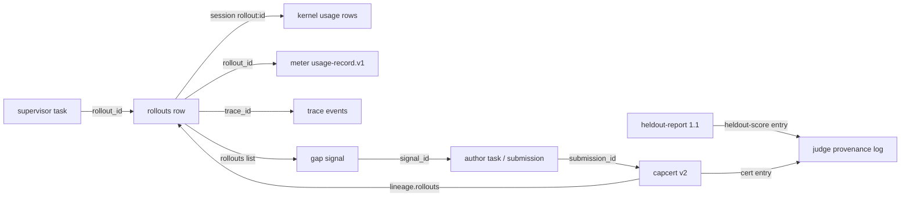

# Feature Specification: Rollout tracking across the kernel and the RSI harness

**Feature Branch**: `spec/013-rollout-tracking`

**Created**: 2026-10-19

**Status**: Draft (owner questions 013-Q1..Q3 in `specs/CLARIFY-LOG.md`)

**Input**: Owner request 2026-10-19: "write up rsi tracking as a spec, try to maintain standardization". Survey of
moeka at `106703ff` (`main`) plus `feat/daily-assistant` (usage-record 1.3), and moeka-rsi at `31e44a7` (its
`core/` pin is `1a47da48`). The harness side is restated by moeka-rsi spec 006 as a pointer to this spec, the same
way moeka `004` points at the harness.

## Problem

One unit of RSI work goes by eight identifiers that nothing joins:

- the supervisor task id (`tasks.id`, `uuid4().hex`, moeka-rsi `src/rsi/db.py:102`), reused as `rollout_id`
- the kernel trace id (`uuid4().hex` per span, `nanobot/kernel/trace.py:116`)
- the usage session (`rollout:<rollout_id>`, moeka-rsi `src/rsi/runner.py:205`)
- the meter's `rollout_id`, resolved from a per-rollout token (moeka-rsi `src/rsi/meter.py:99`)
- `signal_id` (gaps), `submission_id` (author), the certificate id (`cert_id`) and the held-out `run-<ts>` report

The consequences:

- A certificate cannot be traced to the rollouts or signals that motivated it: `lineage` holds only `parent`
  (`schemas/capability-cert.v1.schema.json`).
- The harness constructs `Kernel(env, variant=variant)` without `consumer`, so every kernel usage row from a
  rollout is `consumer = "unattributed"`, which the constitution (VII) counts as a defect.
- Two usage ledgers disagree in format and trust. The kernel ledger is per-rollout SQLite inside
  `rollouts/<id>/state/`, rewritable by an exec-capable agent (`schemas/ATTRIBUTION.md`, "Forging"). The meter's
  `usage.jsonl` is out of the agent's reach, but it is not `usage-record.v1`, carries no `call_id`, and is never
  reconciled with the kernel.
- Held-out reports in worktree mode record `meta.commit = null` (`scripts/heldout_run.py:2324`), so a score cannot
  be tied to code.

## Terms

- **Rollout**: one execution of the kernel by the harness for one task attempt, whatever its origin (rollout task,
  author attempt, seed check, VM pool job). The unit of tracking.
- **Rollout id**: the rollout's identity, an opaque string matching `^[A-Za-z0-9][A-Za-z0-9._:-]{0,63}$`. Existing
  ids (`uuid4().hex`, `a<hex15>-<n>`, `seed-check-<hex12>`, `<ms>-<hex12>`) all match and stay valid.
- **Experiment id**: optional grouping of rollouts that compare candidates under one question (013-Q2). Same
  pattern as the rollout id.
- **Core sha**: the full 40-hex commit of the moeka tree a rollout ran, read by the harness from its `core/`
  submodule, never from inside the rollout.
- **Rollout record**: the joined, host-owned description of one rollout (FR-007).
- **Trusted totals**: usage totals from a producer the observed agent cannot reach (constitution IX).

## Requirements

### Part A: One identity, attributed everywhere

- **FR-001 Consumer.** The harness constructs every kernel with `consumer = "rsi-harness"`
  (`Kernel(..., consumer=...)`, `nanobot/kernel/kernel.py:86`). A rollout that yields any kernel usage row with
  `consumer = "unattributed"` fails the rollout-attribution test (SC-001).
- **FR-002 Session.** Every agent run in a rollout uses session key `rollout:<rollout_id>` (today's convention,
  made normative). The kernel binds it as the typed `session` field; it never travels in `tags`.
- **FR-003 Run tags.** Rollout spans carry these tag keys, registered in `schemas/ATTRIBUTION.md` under a new
  "Rollout tags" section as the only reserved host tags:
  - existing (`rollout_tags()`, moeka-rsi `runner.py:47`): `rollout`, `task`, `seed`, `candidate`, `pool`
  - new: `experiment` (experiment id or absent), `core_sha` (core sha)
  Values obey `sanitize_tags` (`nanobot/kernel/ledger.py:97`: at most 16 tags, keys ≤ 64, values ≤ 120 characters).
  The kernel must carry span tags onto every usage record made inside the span (`_with_span_tags`,
  `nanobot/kernel/llm.py:778`). A test proves this for completions, agent runs and retried calls (SC-001).
- **FR-004 Attribution coverage.** Memory, Dream and router calls inside a rollout bind the active attribution.
  This is moeka `001` T009; this spec makes it a prerequisite for SC-001.
- **FR-005 Identity minting.** The harness mints rollout ids through one function (`rsi.ids.new_rollout_id`),
  returning `uuid4().hex`. Origin (`rollout`, `author`, `seed-check`, `vmspool`) is recorded in the rollout
  record, not encoded in the id. Existing ids are not rewritten.

### Part B: Trusted usage, reconciled

- **FR-006 Meter emits usage-record.v1.** The meter writes each upstream call as a `usage-record.v1` document
  (`schemas/usage-record.v1.schema.json`, 1.3 or later). Fields:
  - `producer = {"name": "rsi-meter", "version": <harness version>}`
  - `consumer = "rsi-harness"`, `session = "rollout:<rollout_id>"`, and `tags` = the rollout's tags from
    `POST /rollouts`
  - `call_id` and `attempt` from the request headers of 013-Q1 when present. When absent, the meter mints its own
    `call_id` and sets `tags.call_link = "none"`.
  The legacy fields `request_digest`, `usage_missing` and `denied` move to `tags`. The meter's file stays
  append-only JSONL outside the rollout's reach. The idempotency key is the schema's `(producer.name, record_id)`.
- **FR-007 Rollout record.** The supervisor keeps one `rollouts` table in `<root>/supervisor.db`, one row per
  rollout. A rollout appears there before it starts and is finalised after its result is collected. Columns:
  - identity and grouping: `rollout_id` (PK), `origin`, `task_id`, `experiment_id`, `candidate`, `seed`
  - run outputs: `core_sha`, `trace_id`, `fingerprint` (digest), `stop_reason`
  - timing: `started_at`, `finished_at` (RFC 3339 UTC)
  - usage: `meter_tokens_in`, `meter_tokens_out`, `meter_cost_usd`, `kernel_tokens_in`, `kernel_tokens_out`,
    `kernel_cost_usd`, `ledger_checkpoint` (from `kernel.usage.checkpoint()`), `reconcile`
  - links: `signal_id`, `submission_id`, `cert_id`, `heldout_report` (filled when those later events name this
    rollout)
  Its export format is `schemas/rollout-record.v1.schema.json` (FR-013).
- **FR-008 Reconciliation.** After a rollout ends, the harness:
  - verifies the kernel ledger against the checkpoint it took at rollout start (`kernel.usage.verify(cp)`)
  - compares the kernel totals for `session = rollout:<id>` with the meter totals for the same rollout
  - sets `reconcile` to exactly one of: `ok` (equal tokens in and out), `mismatch` (both present, unequal),
    `ledger-tampered` (verify failed), `meter-missing`, `ledger-missing`
  Trusted totals are always the meter's. A rollout whose `reconcile` is not `ok` is ineligible as evidence for a
  certificate (FR-010), and the reason is shown by `rsi rollouts show`.

### Part C: Evidence links

- **FR-009 Signals name their rollouts.** A gap signal (`src/rsi/gaps.py`) lists the rollout ids whose traces
  produced it (`rollouts: [...]`, at most 50, newest first). `author_tasks` stores them with the `signal_id`.
- **FR-010 Certificate lineage (capcert v2).** A new `schemas/capability-cert.v2.schema.json` with
  `schema = "moeka.capcert.v2"` adds:
  - `lineage.signals` (signal ids), `lineage.rollouts` (rollout ids with `reconcile = ok`), `lineage.experiment`
    (experiment id or null)
  - `verifier.core_sha` (core sha the verifier ran against)
  Everything else is unchanged from v1. Because v1's `lineage` and `verifier` are closed objects, this is a new
  major version per `schemas/ATTRIBUTION.md` versioning. moeka verifies v1 and v2 (`verify_bundle`,
  `cert_schema_problems`); the reason codes of `012` FR-002 are unchanged. The judge issues v2 only.
- **FR-011 Provenance log payloads.** The judge's hash-chained log (moeka-rsi `src/rsi/judge/provenance.py`) keeps
  its line format and types:
  - `submission` payloads add `signal_id` and `rollouts`
  - `cert` payloads add `cert_id`, `schema` and `rollouts`
  - a new type `heldout-score` records a held-out report that feeds a decision: `report_sha256`, `suite_sha256`,
    `commit`, `tree_sha256`, `experiment_id`, pass/fail counts
  Promotion records (`promotions.jsonl`) add `rollouts` copied from the certificate.
- **FR-012 Held-out reports bind code.** `heldout-report.v1` gains (additive, minor bump to `1.1`):
  - `meta.tree_sha256`: sha256 over the canonical JSON array of `[relpath, sha256(file)]` of the tracked files of
    the tested tree, the same construction as the bundle hash of `012`
  - optional `meta.experiment_id`
  - in worktree mode, `meta.commit` = `HEAD` of the worktree plus `meta.dirty` (bool)
  The runner refuses to write a report with neither `commit` nor `tree_sha256`.

### Part D: Export and consumers

- **FR-013 rollout-record.v1.** `schemas/rollout-record.v1.schema.json` defines one exported rollout record (FR-007
  columns, with `schema_version` `"1.0"`). It is registered in `schemas/validate.py`, with an example in
  `schemas/examples/` and a frozen copy in `tests/schemas/frozen/`, following the existing schema rules. It is
  content-free: no prompts, outputs or paths inside the rollout.
- **FR-014 CLI.** `rsi rollouts show <rollout_id>` prints the joined record and links (signal, submission,
  certificate, held-out score) and the reconcile status. `rsi rollouts trace <cert_id>` lists the rollouts and
  signals behind a certificate. `rsi rollouts export [--since T] [--experiment E]` writes `rollout-record.v1` JSONL
  to stdout.
- **FR-015 Downstream consumers.** hive and awork read rollouts only through the FR-014 export (constitution IX).
  They keep no copy of rollout usage.

### Deferred (owned by moeka 001; required before the loop is enabled by default)

- **FR-016** Cross-process trace stream (`001` FR-006, T019), so the harness stops globbing per-rollout
  `trace.jsonl` files.
- **FR-017** Replay keyed by `request_key` (`001` FR-011, T023), so a rollout can be re-scored deterministically.
- **FR-018** Protected host-owned usage sink (`001` FR-005, T022). Until it exists, the meter is the trusted source
  (FR-008).

### Non-functional

- **NFR-001** Observation stays fail-open (constitution VII). A failure to write a rollout record or a meter line
  is logged and counted, and never fails a model call. A missing record surfaces as `reconcile = meter-missing` or
  `ledger-missing`.
- **NFR-002** Kernel import boundary and zero ambient reads hold. The core sha and experiment id enter only
  through tags the harness supplies.
- **NFR-003** Reconciling one rollout with 1,000 calls takes under 200 ms.

## Join model

## Test Harness Contract

Hidden tests may use only:
- `schemas/rollout-record.v1.schema.json`, `schemas/capability-cert.v2.schema.json` and
  `schemas/usage-record.v1.schema.json`, with `schemas/validate.py`
- `nanobot.capabilities.provenance` (`verify_bundle`, `Verdict`, `TrustStore`, `cert_schema_problems`)
- `moeka.Kernel` with a fake provider, `kernel.usage` (`checkpoint`, `verify`, queries), and the kernel trace sink
- `scripts/heldout_run.py` through its CLI
- in moeka-rsi: `rsi.ids.new_rollout_id`, the `rsi rollouts` CLI, the meter's HTTP API, and `supervisor.db` read-only

## Success Criteria

- **SC-001** A scripted fake-provider rollout (completion, retried call, agent run, Dream call) yields kernel
  usage rows that all have `consumer = "rsi-harness"`, `session = "rollout:<id>"`, and tags `rollout` and
  `core_sha`. No row is `unattributed`.
- **SC-002** For the same rollout through the meter, `reconcile = ok`. Editing one kernel ledger row afterwards
  gives `ledger-tampered`. Dropping the meter file gives `meter-missing`.
- **SC-003** `rsi rollouts trace <cert_id>` on a v2 certificate returns its signal and every listed rollout, each
  with `reconcile = ok`. A rollout with any other status is refused as lineage at issue time.
- **SC-004** moeka verifies a v1 and a v2 certificate built from the same bundle. A v2 certificate with an extra
  `lineage` key is `bad-schema`.
- **SC-005** A held-out run in worktree mode writes `commit`, `dirty` and `tree_sha256`. Changing one tracked byte
  changes `tree_sha256`.
- **SC-006** Each new or changed schema has a frozen copy and passes the compatibility test. `rollout-record.v1`
  and `capcert.v2` examples validate.
