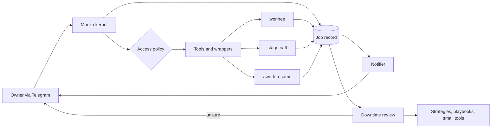

# 015 Central plan: one policy, one job record, one kernel

Status: DRAFT for owner approval (2026-11-11). Nothing here is built. Source: brainstorm with the owner,
including a reconstruction of `telegram:8389948559` seq 168 to 209 (2026-10-26).

## Intent

Make moeka a good agent kernel plus a set of highly integratable tools and wrappers, and stop adding
per-feature exceptions. The niche: **a trustworthy operator for one person's machines and projects**. It is
not the best coder. It adapts to its roles by trial and failure or by being told strategies, remembers and
repeats them, and reviews its own mistakes in downtime to improve itself, with limits.

Why now: when moeka and wonhee misbehave, the owner cannot tell which side failed and has to ssh in or use a
Claude Code session to find out.

Target experience (owner's words, condensed):
- The owner sends a plain request ("run this program on my server and open a port on Tailscale").
- Moeka confirms it heard. If the request is ambiguous it asks one question, then starts.
- Long work never blocks the chat. Status is available on request.
- On finish, moeka reports the concrete result (the port number) and the owner can reach it.

Fit: as moeka core it fits awork-resume on some paths. As full moeka it fits stagecraft and wonhee.

## Goals

- One **job record** is the single source of truth for every request, shared by moeka and every wrapper.
- One **access policy** (read and write grants, hard floor) used by every tool.
- Every failure names its side (moeka, wrapper, wonhee, stagecraft, policy) and its cause.
- Moeka reports on its own when a job ends. A dead turn still reports.
- Self-improvement that is bounded, evidence-driven and reversible.
- Fewer exceptions: new integrations plug in through the wrapper contract instead of special cases.

## Non-goals

- Competing as the best coding agent.
- Replacing wonhee, stagecraft or awork. Moeka drives and observes them.
- A multi-agent swarm platform. Borrow only what is cheap (see phase notes), no new orchestration layer.

## Anti-goals (a failure even if it technically works)

- A status message that is stale or invented.
- A silent dead end (a policy wall or crash that ends in a generic apology).
- Self-improvement that widens its own permissions, edits `SOUL.md`, or builds tools without evidence of reuse.
- A tool library that only grows.

## Decided by the owner

- Access: moeka may work outside the workspace file wall. **Read and write are separate grants.** Write is
  never implied by read.
- Moeka sends a message **on its own** when a job finishes, fails, needs an answer, or ends with an unknown
  outcome. Progress is silent until asked.
- Self-change allowed without approval: remembering a strategy, rewriting a playbook, building a small tool.
- Moeka may message the owner during downtime when unsure or when intent was unclear, including reuse
  questions ("we have done this twice, is it worth a tool?", "are we going to keep doing these tasks?").
- Order of work: job record and wonhee seam first.

## Already built (do not redo; spec 014)

- `tools.file.readRoots`: broad read-only roots, floor stays (`filesystem.py`). This fixes the Oct 26 Stagecraft
  dead end, which happened before it shipped (2026-11-02).
- Wonhee link contract check, marker-file polling, specific failure reasons, stalled-job announcements,
  `/wonhee status` and `/wonhee retry`.
- Self-check gate for deliveries (`creative_checks.py`, `delivery_check` table).
- `view_media`, resilient Telegram media delivery.

## Correction to my earlier reconstruction

I told the owner the finished video was never delivered. Spec 014 already shows that was wrong: bridge
deliveries are sent outside the agent loop and are absent from the session record. What the Oct 26 record
does show is a stale status (the job went from queued to done and the owner was told nothing), a
permission wall that ended the turn with no explanation, and identical timestamps for every message in a
turn, which makes the record useless for timing.

## Design

### Job record
- One durable record per request. States: heard, needs-answer, working, blocked, done, failed,
  outcome-unknown.
- Fields (core, builder to finalize): id, owner request text, role, state, state history with real
  timestamps, clarification asked and answered, artifacts and evidence, failure side and cause, notification
  state (sent, confirmed, retrying), links to wrapper-side ids (wonhee job, stagecraft job, tmux pane).
- Wrappers write their own state transitions into this record. Status is always read from it, never from
  what moeka said earlier.

### Wrapper contract
- Every integration (wonhee, stagecraft, awork-resume, tmux) exposes: typed action, typed receipt, the shared
  job id, a health query, a version or contract handshake.
- The wonhee contract check from 014 is the template. Generalize it, do not fork it.

### Access policy
- Per role or project: a list of roots, each with `read` and optionally `write`.
- Hard floor beneath every grant: sessions, keys, config, auth, peers, personality, locks, usage db.
  Non-removable, not liftable by any grant.
- File tools, exec and tmux read the same grants. A write through the shell to a read-only root is refused
  the same way `write_file` would be.
- A denial names the missing grant and the role, and is written into the job record.
- Only the owner changes grants. Moeka can ask. RSI cannot change them.

### Notification
- Four unprompted moments: done, failed, needs-answer, outcome-unknown.
- The message is built from the job record: state, concrete result, evidence.
- If the loop dies, times out or is blocked, the system (not the model) sends the report from the job record.
- Delivery of the notification is itself tracked and retried.

### Self-improvement
- Review of failed, uncertain and repeated jobs happens in downtime. Actions allowed alone: remember a
  strategy, rewrite a playbook, build a small tool. Each is logged, linked to its evidence, reversible.
- **Tool evidence rule (my proposal):** a tool needs repeated use (count plus job links), an explicit owner
  request, or an owner answer to a reuse question. Otherwise moeka asks instead of building.
- Unused tools are flagged and retired.
- Fixed limits: no `SOUL.md`, no widening of grants, no change to the floor, no touching keys or config.
  Dream's staged skill writes (spec 010) already enforce part of this and stay.

## Phases

1. Job record and wonhee seam. First deliverable. Every wonhee interaction produces job-record transitions with
   side and cause on failure. Real timestamps per message.
2. Access policy: write grants on top of `readRoots`, one policy across file, exec and tmux tools, named
   denials.
3. Notifier and dead-turn report.
4. Downtime review with the tool evidence rule and reuse questions.
5. Stagecraft and awork-resume wrappers on the shared contract.

Each phase must leave the suite green and be reversible on its own.

## Constraints

- Host packages import the kernel, never the reverse (`tests/core/test_import_boundary.py`).
  The job record schema and policy engine live in the kernel. Wrappers and the notifier live in the host.
- `moeka.Kernel` embedders (awork) must get the job record and policy without the gateway.
- Diagrams mermaid only. No `ruff format`.

## Left to the builder

- Exact job-record schema and storage. Decided during phase 1 planning: a kernel-owned `jobs.sqlite3` next to
  `sessions.db` (`nanobot/kernel/jobs.py`), not a table inside `sessions.db`, because `sessions.db` has no
  migration mechanism and kernel stores already use their own files. The sessions-root protection covers it.
- How the policy engine is configured (extend `tools.file.readRoots` into per-role grants is my default).
- Thresholds for the tool evidence rule.
- How the dead-turn report is triggered inside the runner.

## Status

- Phase 1 (2026-11-11): done on `feat/job-record`. `nanobot/kernel/jobs.py` (store), `job_hook.py` (run hook and
  turn factory), `nanobot/creative_jobs.py` (wonhee seam tracker), per-message append stamps in the runner,
  `/jobs`, `/wonhee status` job lines. Not built: linking a chat turn to the wonhee jobs it started.
- Phase 2 (2026-11-11), partly: `tools.file.writeRoots` (a read root never grants write; a write root is also
  readable), denials name the missing grant, and exec's bwrap binds are derived from the same file roots, so a
  read root is read-only in the shell too when `tools.exec.sandbox` is on. tmux is session-scoped
  (`allowed_sessions`), not path-scoped, so it is unchanged. Not built: per-role grants (grants are global
  config for now) and recording the missing grant in the job record beyond the policy cause.
- Owner decisions after phase 2 (2026-11-11): read and write for all of `~/projects` and `/mnt/arteta`
  (applied to the live config); `.env` files unreadable and unwritable inside roots; the agent cannot write
  moeka's own source; the owner can return to a stable version by command. Built as the dotenv floor rule,
  `tools.file.protectSource`, bwrap masks (`granted_root_masks`), `scripts/selfrevert.py` with `/stable`,
  `/revert` and the boot guard. Reading moeka's own source stays allowed.

- Phases 3 to 5 (2026-11-11, `feat/worker-adapter`), reordered to match the owner's intent that moeka is the
  relationship layer that delegates to Claude Code and Codex:
  - Phase 3 (done): job store outbox, routes and links; the system-built dead-turn report; the delayed "heard"
    acknowledgement; the `job_status` tool; `nanobot/job_notifier.py` (proactive, durable, never double-sends,
    reports restart orphans); wonhee jobs attached to the chat turn that started them (heuristic).
  - Phase 5 (done, built before 4): `nanobot/workers/` and the `worker_start`, `worker_follow_up`,
    `worker_inspect`, `worker_stop` tools. Backends are explicit and never fall back (different accounts and
    usage). Claude Code and Codex were both run live under bwrap, and a follow-up resumed the same Claude
    session. Workers run detached and re-attach after a restart.
  - Phase 4 (done): `kernel/job_review.py` and `nanobot/job_review_service.py`; the evidence rule is code (new
    skill needs 3 completed repeats or `/approve-skill`).
  - Not built: the review does not yet draft playbooks or small tools itself (it asks and gates); per-role
    grants; usage budgets per backend beyond the recorded per-account totals.

## Open for the owner

- Which roots and which roles get write on day one.
- Who is the first role beyond the video operator.
